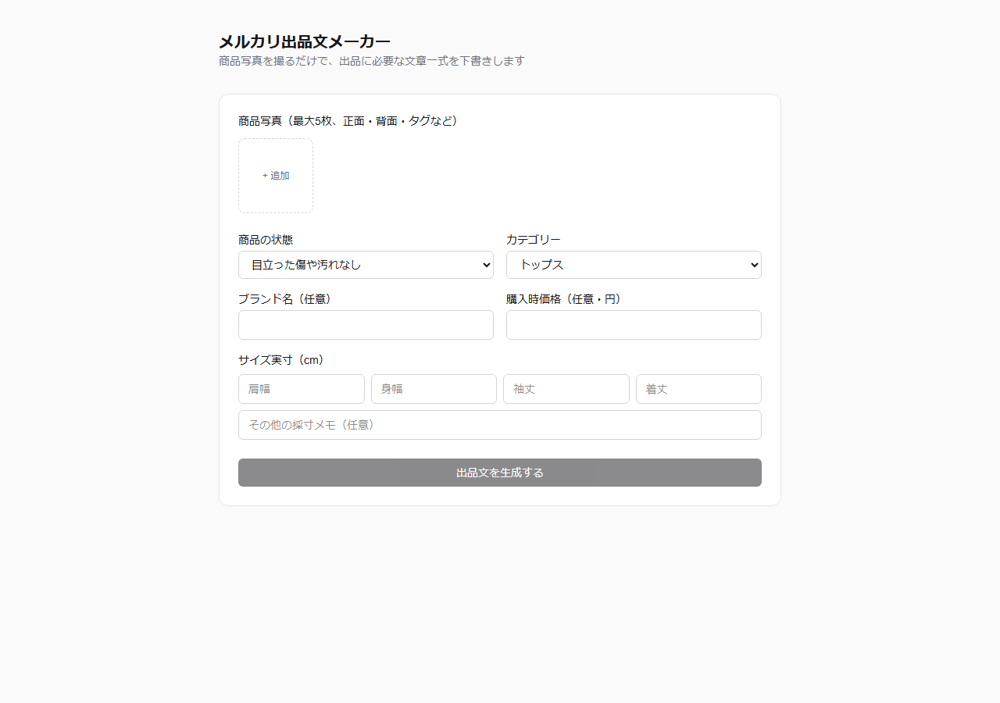

# メルカリ出品文メーカー

商品写真と簡単な手入力情報から、AIがメルカリの出品文を自動で下書きしてくれるツールです。
出来上がった文章はその場で編集し、Googleスプレッドシートに1行として保存できます。

## 公開URL

https://orijinaru1.vercel.app

## スクリーンショット



## 使い方

1. 商品写真をアップロード（最大5枚）
2. 商品の状態・カテゴリー・サイズなどを入力
3. 「出品文を生成する」を押すと、AIが出品文の下書きを作成
4. 画面上で文章を編集し、保存するとGoogleスプレッドシートに自動で1行追加される

## 技術スタック

- [Next.js](https://nextjs.org/) 16（App Router / Cache Components・PPR有効）
- [React](https://react.dev/) 19 / TypeScript
- [Tailwind CSS](https://tailwindcss.com/) 4
- [Vercel AI SDK](https://ai-sdk.dev/)（`generateText` + 構造化出力）/ Google Gemini
- [Zod](https://zod.dev/)（入力・出力のスキーマ検証）
- [googleapis](https://github.com/googleapis/google-api-nodejs-client)（Google Sheets APIへの書き込み）
- [Vercel](https://vercel.com/) にデプロイ

## ローカルでの開発

```bash
npm install
npm run dev
```

[http://localhost:3000](http://localhost:3000) を開くと確認できます。

`.env.local` に以下の環境変数が必要です。

- `GOOGLE_GENERATIVE_AI_API_KEY`
- `GOOGLE_SERVICE_ACCOUNT_KEY`（Google サービスアカウントのJSONをbase64エンコードしたもの）
- `GOOGLE_SHEET_ID`
- `GOOGLE_SHEET_TAB_NAME`（任意）
